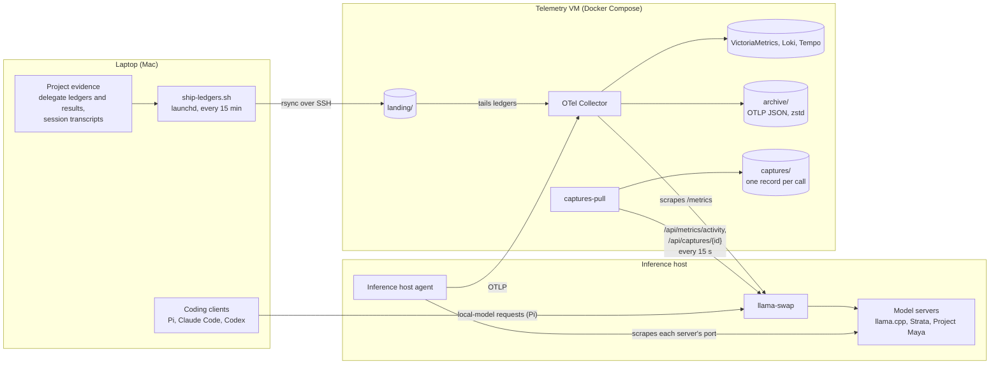
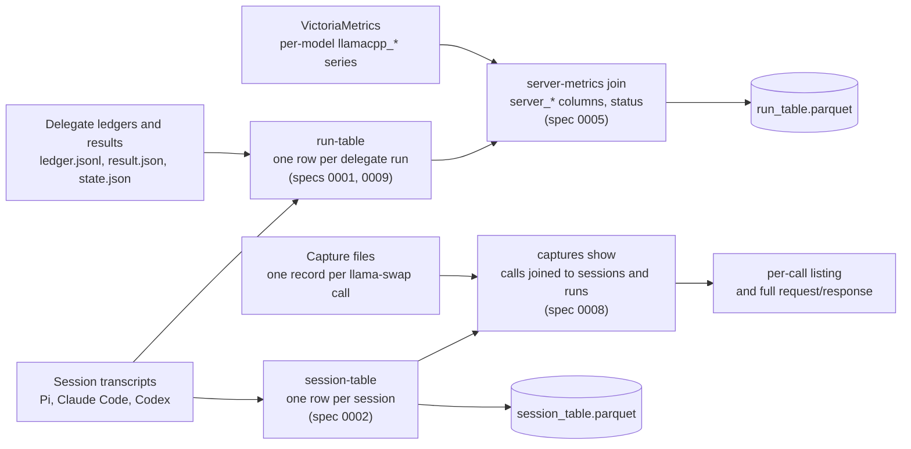

# agentic-telemetry

Collects and analyzes telemetry from coding-agent sessions run with
[agentic-scaffold](https://github.com/bbirkinbine/agentic-scaffold): a collector
stack for a homelab telemetry VM, and a Python package that reads delegate runs,
client session transcripts, local-model server metrics and llama-swap
request/response captures into Parquet tables. Per-model failure matrices and a
review app for labeling runs are planned. Hostnames and addresses in tracked
files are placeholders (RFC 2606, RFC 5737); real values stay in untracked
`.env` files.

> ## Status
>
> Published as a personal lab, not an actively
> maintained product. Issues and PRs are welcome but won't get fast
> turnaround. Pin a specific commit if you depend on a snapshot.

## How it works

Three machines. The laptop runs the coding clients and the analysis; the
inference host serves local models behind llama-swap; the telemetry VM keeps
everything that leaves the laptop or the inference host.



- **Files are the record of truth.** Ledgers, delegate results, transcripts and
  captures stay files; the stores are for queries and dashboards
  ([ADR 0001](docs/adr/0001-duckdb-over-files.md),
  [ADR 0002](docs/adr/0002-grafana-stack-stores-over-langfuse.md)).
- **Nothing scrapes through llama-swap's `/upstream/`**, which would reset a
  model's idle timer. The inference host agent reads each model server on its
  own port, and `captures-pull` reads only llama-swap's `/api/` routes.
- **Transcripts and captures never reach Loki.** The Collector tails only the
  delegate ledgers; transcripts are read in batch, and captures (full request and
  response bodies) stay in `captures/` on the VM.
- The Mac keeps working offline: the ship script skips an unreachable VM and
  catches up on the next run.

The analysis runs on the laptop. The `agentic-telemetry` CLI reads project
evidence in place (or a landing-zone copy), queries VictoriaMetrics over HTTP,
and reads capture files copied from the VM; everything it writes goes to the
ignored `data/` directory:



`collector/README.md` is the detailed design, runbook and verification record
for the collector side; `docs/specs/` holds each feature's decisions and checks.

## Requirements

- Python 3.12 and `uv`
- Docker, for validating and running the collector stack; the `gh` CLI for PRs

## Quick start

```bash
git clone git@github.com:bbirkinbine/agentic-telemetry.git
cd agentic-telemetry
.agentic/toolchain.sh install   # install dependencies
mkdir -p data
uv run agentic-telemetry run-table --out data/run_table.parquet ~/src/my-project
# one row per delegate run, Pi subagent tokens included; see AGENTS.md → How to run things
uv run agentic-telemetry run-table --metrics-url http://telemetry.example:8428 \
  --out data/run_table.parquet ~/src/my-project
# adds server_* columns from the telemetry VM's VictoriaMetrics (read-only): the
# model each run ran on, tokens and throughput from llama.cpp counters, a
# cold-start flag, and a status (joined, overlap, uncovered, ...);
# see docs/specs/0005-server-metrics-join.md
uv run agentic-telemetry session-table --out data/session_table.parquet
# one row per Pi, Claude Code or Codex session, from each client's default session directory
rsync -a telemetry.example:/srv/telemetry/captures/ data/captures/
uv run agentic-telemetry captures show --captures data/captures \
  --session-table data/session_table.parquet --date 2026-10-22
# local-model calls harvested from llama-swap, joined to sessions (spec 0008);
# --session ID or a RUN_ID selects one session, --call N prints one call in full
```

## Repository layout

- `collector/`: the telemetry VM's compose stack (Collector, VictoriaMetrics,
  Loki, Tempo, and the `captures-pull` harvester built from `collector/captures/`)
  with its validated configs; `collector/inference-agent/` scrapes each model
  server on the inference host; `collector/mac-agent/` holds the ledger ship
  script, its launchd template and a laptop-side OTLP buffering agent config
  (not deployed yet); `collector/clients/` holds client config snippets;
  `collector/README.md` is the design, runbook and verification record
- `analysis/`: the analysis plan (design draft): telemetry review vs public
  benchmarks vs private evals, the agent/server join, and the pattern catalog
- `src/agentic_telemetry/`: the Python package: `run_table/`, `session_table/`,
  `server_metrics/` (the VictoriaMetrics join) and `captures/` (the harvester
  and `captures show`)
- `tests/`: the suite
- `docs/specs/`: specs; `docs/adr/`: architecture decisions

## Development

```bash
.agentic/toolchain.sh install   # dependencies
.agentic/toolchain.sh test      # tests
.agentic/toolchain.sh lint      # lint
.agentic/toolchain.sh typecheck # type-check
.agentic/toolchain.sh gate      # all of the above plus the format check
uv run pre-commit install    # commit guard
```

See [`AGENTS.md`](AGENTS.md) for the per-project contract every client
follows (Claude Code imports it through [`CLAUDE.md`](CLAUDE.md)) and
[`WORKFLOW.md`](WORKFLOW.md) for the spec-driven loop.

## Acknowledgements

This project was developed with the assistance of AI tools.

## License

MIT — see [`LICENSE`](LICENSE).
